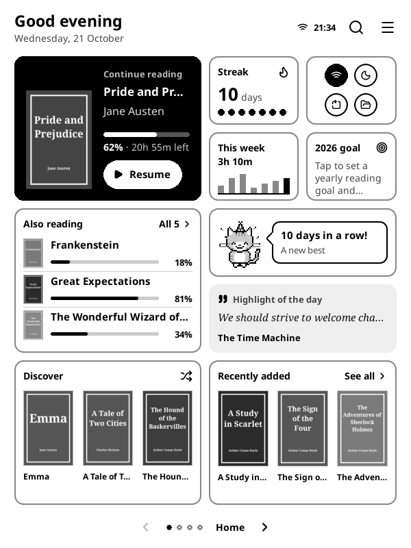
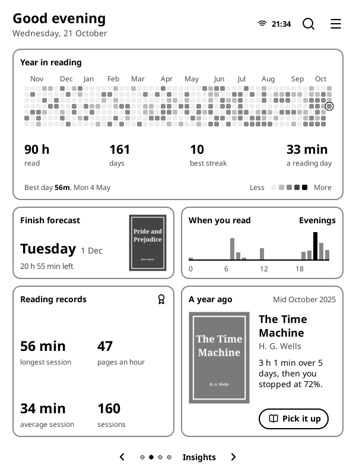
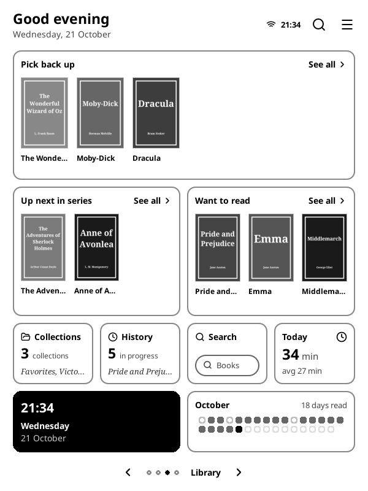
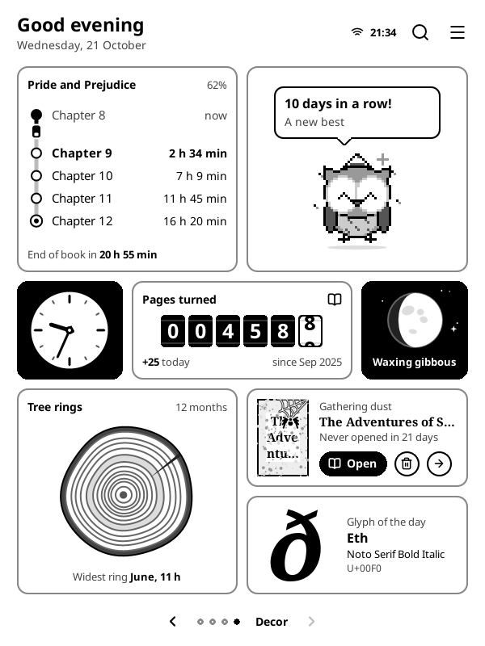
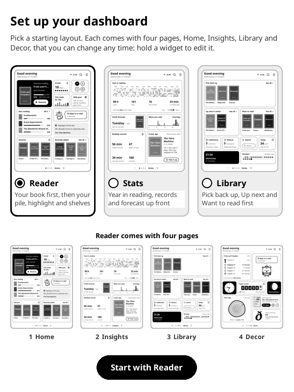
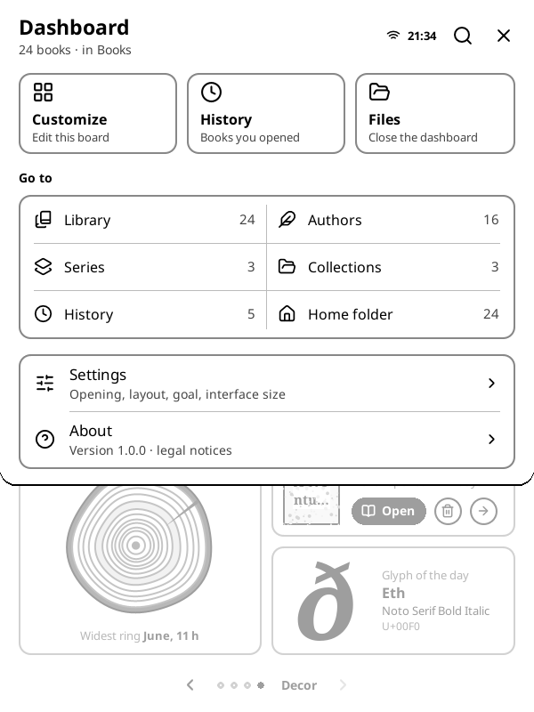

# Reading Dashboard for KOReader

A board of reading widgets that sits over KOReader's file browser. It shows
what you're reading, shelves of your books, reading statistics, a highlight
and a word of the day, quick device toggles, and some decoration.
Everything comes from your device. The plugin makes no network requests and
needs no account.

This is the widget dashboard from the [BookOrbit](https://github.com/bookorbit/bookorbit)
KOReader plugin with everything BookOrbit-specific removed. It is a modified
version and **not an official BookOrbit release** (see [Credits & license](#credits--license)).

| Home | Insights | Library | Decor |
|---|---|---|---|
|  |  |  |  |

| First run | Menu |
|---|---|
|  |  |

## Install

1. Copy the `dashboard.koplugin/` folder into `koreader/plugins/` on your device.
2. Restart KOReader.
3. Open it with the dashboard icon in KOReader's top menu bar (just before the
   main menu), from **Tools → Reading dashboard**, or with a gesture.

The first time it opens, pick a starting layout (Reader, Stats or Library).
Each layout has four pages: Home, Insights, Library and Decor.

## Where the data comes from

| Widget data | Source |
|---|---|
| Books, *Recently added*, *Discover*, *Gathering dust* | Files under KOReader's **home folder** (set it in the file browser) |
| *Continue reading*, *Also reading*, *Pick back up*, History | KOReader's reading history and each book's sidecar (progress, status) |
| *Finished this year*, *Goal pace* | Books marked **Finished** (KOReader's book status, or from the dashboard) |
| *Want to read* | KOReader's **Favorites** collection, minus finished books |
| *Up next in series* | The next unread book of each series you've started (from book metadata) |
| *Streak*, *This week*, *Today*, *Year in reading*, *When you read*, *Records*, *Finish forecast*, *A year ago*, *Pages turned*, *Tree rings* | KOReader's **Statistics** plugin database |
| *Highlight of the day* | Highlights stored in your books' sidecars |
| *Word of the day* | KOReader's **Vocabulary builder** |
| *Chapter line* | A book's table of contents, saved when you close the book |

Covers and metadata for books you haven't opened yet are read once, one book
at a time in the background, and cached under `koreader/cache/readingdashboard/`.

## Using it

- **Swipe** left/right or use the page-turn keys to flip pages. **Swipe down**
  from the top edge, or tap ☰, to open the menu. **Back** returns to the file
  browser.
- **Tap a book** to open it. **Hold** a Continue-reading book (or use the ⋯
  button) for actions: book information, mark finished, reading or on hold,
  collections, show in file browser. Shelf **See all** opens a book list.
- **Hold any widget** to customize: move, resize or remove widgets, move them
  to another page, or **Add widget** from a library of 45 previews, including
  shelves of a specific collection, author or series. Layouts are saved per
  screen shape, so portrait and landscape can differ.
- **Settings** (in the menu):
  - *Opening the dashboard*: show the file browser first, open the dashboard
    at startup, or make the dashboard **home** (at startup and whenever you
    close a book). Also a one-tap gesture shortcut and the menu bar icon.
  - *Board*: starting layout, tile style (Outline, Soft, Ink), interface size
    (1.0x–1.2x), and whether tapping Continue reading opens the book.
  - *Reading goal*: books per year for the Goal pace widget.
- The **Dashboard: open** action can be assigned to any gesture or key in
  KOReader's gesture/hotkey settings. Triggered from inside a book, it closes
  the book and opens the dashboard.

## Repository layout

```
dashboard.koplugin/          the plugin (copy this folder to koreader/plugins/)
  main.lua                   lifecycle, menus, auto-open/home, gesture action
  dashboard_view.lua         the full-screen board widget and its actions
  dashboard_library.lua      local library: scan, metadata, covers, shelves
  dashboard_board_*.lua      layout, widgets, decor art, editing, storage
  dashboard_stats_reader.lua read-only queries on statistics.sqlite3
  dashboard_menu_*.lua, dashboard_settings_page.lua, dashboard_dialog_ui.lua
docs/screenshots/            emulator screenshots (KOReader 2026.07.2, 600x800)
```

Tested in the KOReader 2026.07.2 Linux emulator.

## Credits & license

Powered by BookOrbit:
[https://github.com/bookorbit/bookorbit](https://github.com/bookorbit/bookorbit).

> Copyright (C) 2025-2026 neon.
> Additional copyright is held by the respective BookOrbit contributors.
>
> Licensed under the GNU Affero General Public License, version 3 only, with
> additional terms. This software is provided without warranty. You may
> redistribute and modify it under those terms.

This is a modified version of BookOrbit and is not an official BookOrbit
release. Modified 2026-10-21. See [NOTICE](NOTICE) for what changed.

- [LICENSE](LICENSE): GNU AGPLv3
- [ADDITIONAL_TERMS.md](ADDITIONAL_TERMS.md): BookOrbit's additional terms (attribution, modified-version notice, trademarks)
- [NOTICE](NOTICE): attribution and modification notice

The same attribution and notices appear in the plugin under **Settings → About**.
